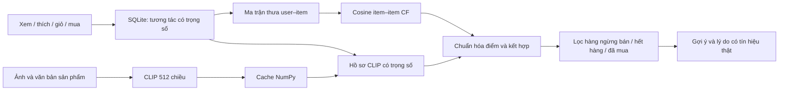

# VELASTYLE — Phong cách là chính bạn

Website thời trang **giao diện tiếng Việt**, FastAPI + React/TypeScript (Vite) + SQLite. Phong cách thiết kế trắng ngà / xanh olive, ảnh thời trang thật, lưới sản phẩm theo mẫu tham khảo, responsive máy tính và điện thoại. Chạy trực tiếp Windows (Docker là tùy chọn), không cần GPU; Node.js chỉ cần khi sửa giao diện (bản build đã có sẵn).

## Chạy trên Windows

Yêu cầu **Python 3.11 trở lên** (khuyến nghị **3.13**; nếu máy có nhiều phiên bản, dùng `py -3.13`). `start.ps1` tự chọn bản mới nhất có sẵn.

```powershell
cd C:\Users\Admin\Downloads\deadlineMyy
py -3.13 -m venv .venv
.\.venv\Scripts\python.exe -m pip install -r requirements.txt
Copy-Item .env.example .env
.\.venv\Scripts\python.exe scripts/init_db.py
.\.venv\Scripts\python.exe scripts/seed_data.py
.\.venv\Scripts\python.exe -m uvicorn app.main:app --host 127.0.0.1 --port 8010
```

Với môi trường đã cài sẵn, chỉ cần:

```powershell
.\start.ps1
```

Website: <http://localhost:8010>. API: <http://localhost:8010/docs>. Trang quản trị: <http://localhost:8010/quan-tri>.

| Vai trò | Email | Mật khẩu mẫu |
| --- | --- | --- |
| Khách hàng | linh@velastyle.vn | Vela@12345 |
| Quản trị | admin@velastyle.vn | Vela@12345 |

Tài khoản mẫu chỉ phục vụ phát triển local. Đổi mật khẩu/xóa tài khoản mẫu trước khi triển khai thực tế. Tài khoản tự đăng ký luôn có quyền khách hàng; API quản trị kiểm tra quyền ở máy chủ.


## Docker, CI và migration (tùy chọn)

- **Docker** (chưa được chạy thử trong repo này, cần Docker Desktop): `docker compose up --build` rồi mở <http://localhost:8010>. Image dùng PyTorch bản CPU; `data/` và ảnh upload nằm trong volume. Embedding CLIP chưa có sẵn trong image, hãy tạo ở trang quản trị **Gợi ý & mô hình AI**.
- **CI**: `.github/workflows/ci.yml` chạy `pytest`, kiểm tra migration khớp model (`alembic check`) và `node --check` cho JS khi push.
- **Migration**: schema do `app/services/migrations.py::upgrade_database()` quản lý (tạo bảng, ALTER cũ, rồi Alembic). Khi sửa model, tạo revision: `.\.venv\Scripts\python.exe -m alembic revision --autogenerate -m "mô tả"`, xem lại file trong `db_migrations/versions/` (phải idempotent), rồi chạy lại server hoặc `scripts/init_db.py`. DB cũ chưa có bảng `alembic_version` được nhận tự động; sao lưu `data/velastyle.db` trước khi nâng cấp.
- Phát triển: `pip install -r requirements-dev.txt` (kèm `httpx2` cho TestClient của Starlette).

## Giao diện React, ALS và SigLIP (tùy chọn)

- **Giao diện React** (`frontend/`: React 19, TypeScript, Vite, react-router). Bản build nằm sẵn trong `app/static/dist`, nên chạy dự án không cần Node.js. Khi sửa giao diện: `cd frontend; npm ci; npm run dev` (Vite proxy tới server :8010), rồi `npm run typecheck; npm test; npm run build` và commit `app/static/dist`. Đặt `FRONTEND=legacy` trong `.env` để quay lại giao diện JavaScript thuần cũ (`app/static/js`); server cũng tự dùng bản cũ khi chưa có `app/static/dist`. Markup, class và `data-*` giữ nguyên nên cùng CSS và cùng script QA (`scripts/*_qa.py`) chạy được trên cả hai bản.
- **ALS** (`app/ai/als.py`): phân rã ma trận ngầm định (ALS-WR, NumPy thuần) trên cùng ma trận tương tác với CF. Có tại `GET /api/recommendations/als` và là phương pháp thứ tư trong **Đánh giá mô hình** của trang quản trị; không đưa vào ba chế độ của trang "Dành riêng cho bạn". Mặc định nhỏ (4 nhân tố, regularization 10) vì dữ liệu mẫu chỉ có khoảng 50 người dùng. Đo ngày 26/10/2026 trên 51 người dùng test mô phỏng (K=10, NDCG): CF 0,207 · ALS 0,192 · Hybrid 0,168 · CLIP 0,014. Tham số ALS được chọn bằng lưới nhỏ trên chính tập này nên số của ALS hơi lạc quan.
- **SigLIP / SigLIP 2** thay CLIP: đặt `CLIP_MODEL=google/siglip2-base-patch16-224` trong `.env` (lần đầu tải về cache Hugging Face, khoảng 1,5 GB), rồi vào **Gợi ý & mô hình AI → Tạo / cập nhật CLIP** (257 sản phẩm mất khoảng 3 phút trên CPU). Vector 768 chiều lưu ở `data/embeddings/<tên-mô-hình>/`; đổi mô hình làm mọi embedding cũ không còn hợp lệ cho tới khi tạo lại, và số liệu đánh giá đổi theo. Đo ngày 26/10/2026 trên bản sao dữ liệu (cùng 51 người dùng, K=10, NDCG): chỉ-CLIP 0,014 → 0,019, Hybrid 0,168 → 0,174, chênh lệch nhỏ. Mặc định vẫn là CLIP ViT-B/32 để khớp báo cáo luận văn.

## Nâng cấp giao diện & dữ liệu

Banner trang chủ và trang **Dành riêng cho bạn** được thiết kế riêng theo phong cách tạp chí: ảnh xếp lớp, typography lớn, huy hiệu vòng quay, điều hướng bộ sưu tập bằng thumbnail, bảng cảm hứng cá nhân và thẻ gu lấy từ sở thích thật. Các phần này nằm trong `atelier.js` / `atelier.css`, dùng API gợi ý hiện có. Có chuyển động nhẹ theo con trỏ trên máy tính; hỗ trợ bàn phím và giảm chuyển động. Kiểm tra riêng bằng `python scripts/atelier_qa.py` (cần Chrome, Playwright và máy chủ đang chạy).

- Trang chủ gồm ba bộ sưu tập trình chiếu (có tạm dừng và điều khiển), bốn nhóm khám phá có số lượng thật, lưới tuyển chọn, câu chuyện mùa, hàng mới kéo ngang, bốn phong cách, chọn gu ba bước, sản phẩm được quan tâm, ba cẩm nang đầy đủ và FAQ.
- Hiệu ứng xuất hiện theo vùng nhìn, chuyển trang, đổi tab không tải lại cả trang, chuyển ảnh banner, hover ảnh/nút, phản hồi yêu thích, mở modal và accordion. Tự ngừng trình chiếu khi trang bị ẩn hoặc người dùng đang tương tác. `prefers-reduced-motion` tắt các chuyển động không cần thiết.
- Tìm kiếm gợi ý có debounce; lọc phong cách/ưu đãi và chip bỏ từng điều kiện; bộ lọc dạng ngăn kéo trên điện thoại; phân trang rút gọn khi nhiều trang.
- Trang chi tiết có phóng to ảnh, bảng kích thước trong modal, chọn số lượng gắn với tồn kho, thông tin chất liệu/chăm sóc/giao hàng dạng accordion, đánh giá mẫu có nhãn và nút thêm giỏ cố định trên điện thoại.
- Giỏ hàng có tiến độ miễn phí vận chuyển, chỉ dẫn các bước đặt hàng, tóm tắt cố định trên desktop. Cỡ chữ và khoảng cách được điều chỉnh trên cả các trang tài khoản và quản trị.
- Mở rộng dữ liệu bằng `python scripts/expand_demo.py`; `seed_data.py` tự gọi bước này. Có thể tái tải 240 ảnh và manifest qua `python scripts/prepare_fashion_dataset.py` (cần mạng). Script này dùng ảnh độ phân giải cao đúng source ID, không dùng lặp ảnh.
- Đã sinh CLIP thật cho cả 257 sản phẩm; sau khi thêm sản phẩm mới, chạy lại tạo embedding trước khi so sánh đầy đủ các mô hình.

```powershell
# Kiểm tra các tương tác mới: slider, quiz, chip lọc, tìm gợi ý, zoom, số lượng,
# cẩm nang, bố cục mobile, hỗ trợ giảm chuyển động và ảnh chụp mới
.\.venv\Scripts\python.exe scripts/upgrade_qa.py
```

## Chức năng đã triển khai

- Trang chủ, menu, tìm kiếm, trang catalog có lọc giới tính, danh mục, thương hiệu, giá, màu, size; sắp xếp và phân trang.
- Chi tiết thiết kế, xem nhanh, chọn size, đánh giá, danh sách yêu thích, lịch sử tương tác và hồ sơ sở thích.
- Đăng ký với tên, tên đăng nhập, email, số điện thoại, mật khẩu và nhập lại mật khẩu; xác nhận email bằng mã 6 số (hết hạn 10 phút, gửi lại tối thiểu sau 2 phút). Đăng nhập bằng email hoặc tên đăng nhập; quên mật khẩu nhận mã qua email; đăng nhập/đăng ký bằng Google (OAuth 2.0). Mật khẩu Argon2; phiên đăng nhập ngẫu nhiên lưu hash trong SQLite, cookie HttpOnly/SameSite. Không dùng mật khẩu hoặc user ID do client khai báo để thay quyền truy cập.
- Cấu hình SMTP và Google trong `.env` (xem `.env.example`). Chưa cấu hình SMTP thì mã xác nhận được ghi trong cửa sổ chạy server (chế độ dev). Tài khoản có sẵn trước bản này được coi là đã xác nhận email.
- Giỏ hàng lưu trong database, cập nhật số lượng, xóa, tính vận chuyển, đặt hàng **mô phỏng**, lịch sử đơn. Giảm tồn kho có điều kiện trong cùng transaction; hủy đơn có hoàn tồn kho và kiểm soát chuyển trạng thái.
- Gợi ý CF, CLIP và Hybrid từ API; gợi ý cá nhân hóa tại trang chủ khi đăng nhập; cold-start từ mức độ phổ biến và sở thích đăng ký.
- Tìm bằng ảnh tải lên qua CLIP thật. Kiểm tra định dạng, dung lượng 5 MB và độ phân giải 25 MP. Không lưu ảnh tìm kiếm.
- Quản trị sản phẩm (tải ảnh thật, thêm/sửa/ngừng bán), CRUD danh mục/thương hiệu, danh sách người dùng, đơn hàng, tương tác, dataset và cấu hình AI.
- Tạo embedding, xây lại CF, chạy đánh giá ở background thread; trả ID tác vụ để giao diện thăm dò trạng thái và xem lỗi. Tác vụ bị ngắt khi khởi động lại được đánh dấu thất bại.
- Dashboard và biểu đồ lấy số liệu từ SQLite; chỉ hiển thị đánh giá khi đã chạy thực tế.

## CLIP thật và chuẩn bị mô hình

```powershell
.\.venv\Scripts\python.exe scripts/generate_embeddings.py
.\.venv\Scripts\python.exe scripts/train_cf.py
.\.venv\Scripts\python.exe scripts/evaluate_models.py 5
```

Hoặc đăng nhập quản trị → **Gợi ý & mô hình AI** → tạo đặc trưng → xây dựng CF → **Đánh giá mô hình**.

CLIP `openai/clip-vit-base-patch32` chạy PyTorch trên CPU. Lần đầu cần mạng để tải trọng số từ Hugging Face (hàng trăm MB, lưu trong cache của máy). Lần sau tái sử dụng cache. Encoder nạp lười một lần mỗi tiến trình và tái sử dụng. Sinh embedding trước, không chạy CLIP cho cả catalog trong mỗi lượt xem trang.

Ảnh hợp lệ được encode thành 512 chiều; văn bản dùng metadata tiếng Anh có sẵn vì CLIP này được tối ưu cho tiếng Anh. Kết hợp `normalize(0.6 × ảnh + 0.4 × văn bản)`. Thiếu ảnh dùng vector văn bản thật và ghi `image_available=False`. Fingerprint bao gồm model, metadata và nội dung ảnh; không dùng embedding ngẫu nhiên, không dùng kết quả cũ sau khi sản phẩm đổi. Vector ảnh, văn bản và kết hợp lưu `.npz`; database lưu metadata và đường dẫn.

Khi chưa có embedding, trang mua sắm vẫn chạy; API ghi rõ fallback phổ biến hoặc cùng danh mục. Tìm bằng ảnh báo HTTP 503 thay vì giả lập CLIP.

## Nguyên lý gợi ý



CF sử dụng SciPy CSR và cosine similarity giữa vector tương tác của từng item; bỏ đường chéo, tính tổng similarity có trọng số theo profile. Trọng số xem=1, yêu thích=3, giỏ=4, mua=5. API view debounce 30 phút; lúc xây profile/CF khống chế một hành vi user–item mỗi ngày để giảm spam.

`Hybrid = α × scale(CF) + (1 − α) × scale(CLIP)`, với `scale(x) = max(x, 0) / max(x)`. α mặc định 0,5, điều chỉnh trên admin. α hiệu dụng giảm khi dưới 5 sản phẩm tương tác; thành phần không có tín hiệu được bỏ. Sản phẩm đã mua bị loại khỏi gợi ý, nhưng vẫn tìm được trong catalog. Không đủ tín hiệu thì trả fallback được ghi rõ trong API.

CF được tính từ lịch sử SQLite hiện tại nên tương tác mới có tác dụng ngay. Lệnh xây lại CF cũng lưu snapshot ma trận similarity cho báo cáo. Với catalog lớn, nên chuyển sang model cache có version và job queue riêng thay vì xây ma trận nhỏ mỗi request như bản local này.

## Đánh giá có kiểm soát

Mỗi người có ít nhất 3 sản phẩm khác nhau: giữ sản phẩm tương tác cuối làm test. Loại **mọi tương tác với sản phẩm test của chính người đó** và mọi sự kiện từ thời điểm cutoff trở đi khỏi train. Chỉ dùng train để xây CF và profile CLIP. Không dùng lịch sử test để xếp hạng.

Ba phương pháp dùng cùng tập ứng viên: toàn catalog đang hoạt động, trừ sản phẩm đã thấy trong train. Mọi item ngoài target là negative candidate; không negative sampling. Tính Precision@K, Recall@K, NDCG@K, Hit Rate, Catalog Coverage và thời gian chấm điểm/xếp hạng. Latency không gồm tải model, I/O, tạo embedding.

Cần tối thiểu 3 người đánh giá hợp lệ và embedding cho mọi sản phẩm để chạy so sánh. Với một target mỗi người, Recall bằng Hit Rate. Catalog nhỏ và K lớn có thể tạo Recall cao; không xem đó là bằng chứng chất lượng trên dữ liệu thương mại.

## Dữ liệu mẫu và phạm vi

**Catalog hiện có 257 thiết kế đang bán: 17 thiết kế biên tập và 240 sản phẩm Fashion Product Images có ảnh gốc khác nhau, độ phân giải 960×1280.** Có 52 tài khoản, hơn 6.100 tương tác, 274 đánh giá mẫu và 84 đơn hàng lịch sử mô phỏng (ngoài các đơn phát sinh khi kiểm tra). Các bản ghi mẫu có nhãn rõ ràng. Script mở rộng idempotent, không ghi đè tồn kho hoặc dữ liệu người dùng đã có.

Tên thương hiệu, mô tả, giá, tồn kho, tài khoản và tương tác seed là dữ liệu minh họa, không phải dữ liệu kinh doanh. Đơn hàng không thu tiền và không vận chuyển thật. Kết quả đánh giá trên seed được ghi nhãn mô phỏng trong dashboard.

Nguồn ảnh biên tập: `app/static/images/assets.json` (Unsplash). Catalog mở rộng: `app/static/images/catalog-manifest.json`; ảnh gốc Myntra được ghép đúng mã dữ liệu Fashion Product Images. Nguồn và ghi chú giấy phép: `catalog-provenance.json`. Kaggle liệt kê MIT, mirror metadata không có LICENSE riêng; quyền nhãn hiệu và ảnh thương mại thuộc chủ sở hữu nguồn. Dùng trong phạm vi đồ án theo điều khoản nguồn. Font Be Vietnam Pro / Playfair Display tải từ Google Fonts, lưu cục bộ theo giấy phép SIL OFL. Toàn bộ UI cơ bản hoạt động offline sau khi đã cài thư viện; CLIP cần tải cache lần đầu.

```powershell
# Khôi phục ảnh từ manifest nếu ảnh bị thiếu
.\.venv\Scripts\python.exe scripts/download_images.py

# Xuất catalog đang có thành CSV mẫu
.\.venv\Scripts\python.exe scripts/export_catalog.py

# Chuẩn hóa CSV: bỏ thiếu tên/giá/ảnh và trùng tên
.\.venv\Scripts\python.exe scripts/preprocess.py data/raw/source.csv data/processed/products.csv

# Nhập CSV; bỏ trùng tên, báo lỗi từng dòng, không tải ảnh tùy ý từ Internet
.\.venv\Scripts\python.exe scripts/import_dataset.py data/processed/products.csv
```

Các cột: `name,description,price,gender,color,material,style,thumbnail,category,brand,clip_text`; tùy chọn `stock,sizes,original_price`. `sizes` dùng dấu `|` (ví dụ `S|M|L`). `thumbnail` là đường dẫn `/static/images/ten-anh.jpg` hoặc `/static/uploads/ten-anh.jpg` có thật trên máy. Importer tạo danh mục/thương hiệu khi cần, validate bằng Pydantic và xử lý transaction từng dòng. Sau import, tạo/cập nhật embedding.

## Kiểm thử

```powershell
.\.venv\Scripts\python.exe -m pytest -q

# Chạy thêm tích hợp pretrained CLIP thật (cần model cache/mạng lần đầu)
$env:RUN_CLIP_TESTS = '1'
.\.venv\Scripts\python.exe -m pytest -q
```

Kiểm thử dùng SQLite tạm riêng, không tác động database đang sử dụng. Bao phủ auth, quyền admin, CSRF khác origin, CRUD, filter/sort, giỏ/đặt hàng/tồn kho, debounce, favorite, cold-start, CF, công thức hybrid, cosine, chống leakage, chỉ số xếp hạng và API gợi ý. Tích hợp CLIP kiểm tra vector ảnh/văn bản thật và chuẩn L2.

Kiểm tra trình duyệt tùy chọn (Chrome cài sẵn trên Windows):

```powershell
.\.venv\Scripts\python.exe -m pip install -r requirements-dev.txt
# Mở máy chủ ở cửa sổ terminal khác trước
.\.venv\Scripts\python.exe scripts/browser_qa.py
```

Ảnh chụp trong `artifacts/`: trang chủ desktop/mobile, xem nhanh, tìm sản phẩm, gợi ý, giỏ hàng, tìm ảnh. Không bắt buộc Playwright để chạy ứng dụng.

## Cấu trúc và lưu trữ

`app/models` là schema SQLAlchemy với khóa ngoại/ràng buộc/chỉ mục; `schemas` kiểm tra đầu vào; `repositories` đọc/serialize catalog; `services` auth, tương tác, seed; `routes` API thương mại và quản trị; `ai` xử lý CF, CLIP, Hybrid và đánh giá; `templates` shell Jinja2; `static` CSS/JS/ảnh/font.

API không tin user ID do client truyền; luôn lấy người dùng từ session. Frontend dùng Fetch API và server API thật. Jinja2 escape template, JavaScript escape dữ liệu trước khi render. Image path bị giới hạn trong thư mục static; upload được giải mã và mã hóa lại JPEG với tên ngẫu nhiên. Không cho frontend tự ghi sự kiện purchase/cart/favorite giả qua `/api/interactions`.

Database `data/velastyle.db`, ảnh upload, cache model, `.env` và NumPy embeddings không đưa vào Git. Giao diện React đã được build sẵn vào `app/static/dist`; chỉ cần Node.js khi sửa `frontend/src`. `COOKIE_SECURE=true` khi dùng HTTPS. Đây là bản local một tiến trình; chưa thiết kế cho nhiều worker, payment thật, khôi phục mật khẩu qua email hoặc huấn luyện phân tán. Không xuất bản lên Sites vì runtime Sites không hỗ trợ backend Python/PyTorch theo yêu cầu.
